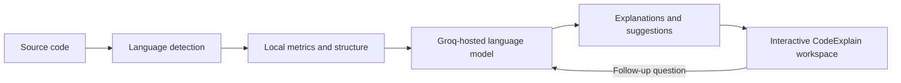

# CodeExplain

### An NLP-assisted workbench for understanding code

CodeExplain turns source code into clear explanations, structural insights, and learning tools. Explore a snippet in the editor, inspect its symbols and metrics, ask questions in plain language, and use AI-generated walkthroughs to make unfamiliar code easier to reason about.

The project combines lightweight, local code parsing with a large language model (LLM). Local analysis extracts approximate code structure and metrics; language-model features translate that context into human-readable explanations, suggestions, diagrams, and quizzes.

> **In short:** bring code you want to understand; leave with a clearer picture of what it does, how it is organized, and what to investigate next.

---

## Contents

- [Why CodeExplain](#why-codeexplain)
- [What you can do](#what-you-can-do)
- [How it works](#how-it-works)
- [Supported languages](#supported-languages)
- [Get started](#get-started)
- [Configure the AI provider](#configure-the-ai-provider)
- [Run in development](#run-in-development)
- [Build and run for production](#build-and-run-for-production)
- [API overview](#api-overview)
- [Technology](#technology)
- [Project structure](#project-structure)
- [Privacy and responsible use](#privacy-and-responsible-use)
- [Troubleshooting](#troubleshooting)
- [Contributing](#contributing)
- [License](#license)

## Why CodeExplain

Reading code is more than recognizing syntax. Developers need to connect functions, data, control flow, edge cases, and complexity—and then communicate that understanding to someone else.

CodeExplain is designed to help with that process:

- **Understand:** turn dense or unfamiliar code into step-by-step explanations.
- **Navigate:** inspect extracted symbols and code relationships in a visual workspace.
- **Question:** ask focused questions about code in natural language.
- **Learn:** generate code-specific quizzes and explanations at different levels.
- **Review:** surface possible quality concerns and ideas for optimization or refactoring.

CodeExplain is an exploratory assistant, not a compiler, static-analysis authority, or substitute for code review. Treat generated explanations and recommendations as helpful starting points and verify them against the source.

## What you can do

### Explore code in context

- Work with code in the editor and file explorer.
- Detect common languages from file extensions, with simple content-based fallbacks.
- Inspect approximate local metrics, extracted symbols, and code relationship graphs.
- Use the analysis workspace to move between overview, explanation, quality, optimization, visualization, and quiz views.

### Turn code into explanations

- Get a plain-language overview of a snippet and its execution flow.
- Review step-by-step and line-oriented explanations.
- Explore the same code from beginner, expert, or interview-preparation perspectives.
- Select a function or code line for more focused context.

### Ask code questions

Use the contextual chat to ask questions about a snippet, a function, its variables, or its behavior. Chat requests include the selected code and conversation history so responses can stay grounded in the current context.

### Search your project in natural language

Search the currently loaded project with questions such as “where is user input validated?” Queries are rewritten locally to remove question framing and generic code-search filler, then ranked with BM25 and code-aware identifier tokenization. Search runs in the browser against the files you have loaded; it does not send source code to the AI provider. This is lexical information retrieval rather than embedding-based vector search. The Search panel also surfaces heuristic code concepts—such as input validation, error handling, and sorting—with file counts; selecting a concept starts a focused search.

### Learn and improve

- Generate multiple-choice and code-reasoning quiz questions.
- Request refactoring ideas and an alternative code sample.
- Request performance-oriented optimization suggestions.
- Review time and space complexity estimates.
- Generate Mermaid flowchart descriptions and candidate test suites.

These are AI-generated suggestions. CodeExplain does not execute generated code or guarantee that suggested changes, tests, complexity estimates, or security observations are correct.

## How it works

CodeExplain uses a two-part analysis workflow:

1. **Local structural pass:** the server detects a likely language and runs lightweight, language-aware heuristics to estimate metrics and extract symbols and graph data.
2. **Language-model pass:** the server sends the code and relevant local context to Groq's chat-completions API. The configured Llama model generates explanations and other requested outputs.
3. **Interactive exploration:** the application presents the returned analysis in its editor and workspace, where you can ask follow-up questions or request another analysis.

Natural-language project search is a separate, browser-local workflow. It splits loaded source files into declaration-oriented chunks and uses BM25 with code-aware tokenization and lightweight concept expansion to rank matches. It also labels chunks with heuristic concepts based on source-code tokens and aggregates those into clickable, file-counted concepts in the Search panel. Search does not require an AI API key.



The local parser is intentionally lightweight: its metrics and extracted structure are useful context, but they are not a full compiler-grade abstract syntax tree or a guarantee of semantic correctness. The AI component uses prompts to produce natural-language analysis. Project search uses lexical BM25 ranking and concept expansion; it does not currently implement embeddings, vector search, or a separately trained NLP model.

## Supported languages

Language detection currently recognizes these extensions:

| Language | Recognized extensions |
|---|---|
| Python | `.py`, `.ipynb` |
| JavaScript | `.js`, `.jsx`, `.mjs` |
| TypeScript | `.ts`, `.tsx` |
| Java | `.java` |
| C++ | `.cpp`, `.cc`, `.cxx`, `.h`, `.hpp` |
| C | `.c`, `.h` |
| Go | `.go` |
| Rust | `.rs` |
| Kotlin | `.kt`, `.kts` |
| Swift | `.swift` |
| PHP | `.php` |
| Ruby | `.rb`, `.gemspec` |

When a filename does not identify a language, a small set of source-pattern checks is used, with JavaScript as the fallback. Recognition does not imply that every language feature is parsed or analyzed with equal depth.

## Get started

### Prerequisites

- [Node.js](https://nodejs.org/) 18 or newer
- npm (included with Node.js)
- A Groq API key for AI-powered analysis and chat

### Clone and install

```bash
git clone https://github.com/srishtipandey1/codeexplain.git
cd codeexplain
npm install
```

### Add your API key

Create a `.env` file in the project root and add your Groq key:

```env
GROQ_API_KEY=your_groq_api_key_here
GROQ_MODEL=openai/gpt-oss-120b
```

The repository includes an `.env.example` template. On Windows PowerShell, you can copy it with:

```powershell
Copy-Item .env.example .env
```

Then open `.env` and replace the placeholder value. Keep your real key private; do not commit it.

## Configure the AI provider

The server reads the following environment variables:

| Variable | Required | Purpose |
|---|---:|---|
| `GROQ_API_KEY` | Yes, for AI features | Authenticates requests to the Groq API. |
| `GROQ_MODEL` | No | Groq model ID. Defaults to `openai/gpt-oss-120b`. |
| `APP_URL` | No | Present in the example template, but not currently read by the server. The server listens on port `3000`. |

The integration calls Groq's OpenAI-compatible chat-completions endpoint. The default model is `openai/gpt-oss-120b`; set `GROQ_MODEL` to another model available to your Groq account to override it.

## Run in development

Start the application from the project directory:

```bash
npm run dev
```

The Express server and Vite development middleware run together. Open **http://localhost:3000** in your browser.

On Windows PowerShell, the full command sequence is:

```powershell
cd .\codeexplain
npm install
Copy-Item .env.example .env
# Add your GROQ_API_KEY to .env before using AI features.
npm run dev
```

## Build and run for production

Build the frontend assets and bundle the server:

```bash
npm run build
```

Then run the production server:

```bash
npm run start
```

The production server serves the built application from `dist` and listens on port `3000`.

## API overview

The Express server exposes these routes:

| Method | Route | Purpose |
|---|---|---|
| `GET` | `/api/health` | Basic server health check. |
| `POST` | `/api/analyze` | Combine local metrics and structure with an AI-generated code analysis. |
| `POST` | `/api/chat` | Ask a question about code, optionally with chat history. |
| `POST` | `/api/quiz` | Generate code-based questions; accepts an optional difficulty. |
| `POST` | `/api/optimize` | Request performance-oriented code suggestions. |
| `POST` | `/api/refactor` | Request a refactored version and a summary of changes. |
| `POST` | `/api/complexity` | Request time- and space-complexity analysis. |
| `POST` | `/api/flowchart` | Request a Mermaid flowchart and step descriptions. |
| `POST` | `/api/tests` | Request a candidate test suite and test-case descriptions. |

The analysis routes accept JSON request bodies. For example:

```json
{
  "code": "function greet(name) { return `Hello, ${name}`; }",
  "filename": "greet.js",
  "language": "JavaScript"
}
```

For AI-backed routes, configure `GROQ_API_KEY` before sending requests. The server returns an error if the key is missing or the provider request fails.

## Technology

- **Frontend:** React 19, TypeScript, Vite 6
- **Editor:** Monaco Editor
- **Styling:** Tailwind CSS 4
- **Motion and icons:** Motion, Lucide React
- **Server:** Node.js, Express 4, `tsx`
- **AI integration:** Groq chat-completions API
- **Production bundling:** Vite and esbuild

## Project structure

```text
codeexplain/
├── server.ts                     # Express API and Vite/production server
├── vite.config.ts                # Vite, React, Tailwind configuration
├── src/
│   ├── App.tsx                   # Main application and workspace behavior
│   ├── main.tsx                  # React application entry point
│   ├── index.css                 # Global styles
│   ├── components/               # Editor workspace, visualization, quiz, export UI
│   ├── services/
│   │   ├── groq.ts               # Prompt construction and Groq API requests
│   │   └── parser.ts             # Language detection and local code heuristics
│   └── types/
│       └── analysis.ts           # Shared analysis and application types
├── .env.example                  # Environment variable template
└── package.json                  # Dependencies and project scripts
```

## Privacy and responsible use

CodeExplain runs its web application and API server locally during development, but AI-powered features send the relevant code and prompts to Groq for processing. Do not submit secrets, credentials, personal data, or code that you are not authorized to share with the configured provider. Review the provider's current data-handling terms before using this project with sensitive source code.

AI-generated explanations, complexity estimates, quality observations, tests, and refactorings can be incomplete or incorrect. Review all outputs, run generated tests yourself, and validate suggested code changes before using them.

## Troubleshooting

### `GROQ_API_KEY is not defined`

Make sure `.env` is in the repository root, contains a valid `GROQ_API_KEY`, and was saved before starting or restarting the server.

### The application does not open at port 3000

Confirm that the development server started successfully. If another process is already using port `3000`, stop that process or change the server's port in `server.ts`.

### AI requests fail

Check that the API key is valid, your network can reach Groq, and your account can access the configured model. Inspect the terminal running the server for the reported provider error.

### Language detection looks wrong

Use a recognized filename extension or select the intended language in the application where available. Content-based detection is heuristic and defaults to JavaScript when it cannot identify a language.

## Contributing

Contributions are welcome. Before opening a pull request:

1. Install dependencies with `npm install`.
2. Run the TypeScript check with `npm run lint`.
3. Build the production bundle with `npm run build`.
4. Describe the behavior you changed and how you verified it.

Please avoid committing `.env` files, API keys, or other credentials.

## License

This project is distributed under the MIT License. See the [LICENSE](./LICENSE) file if present in your checkout.
