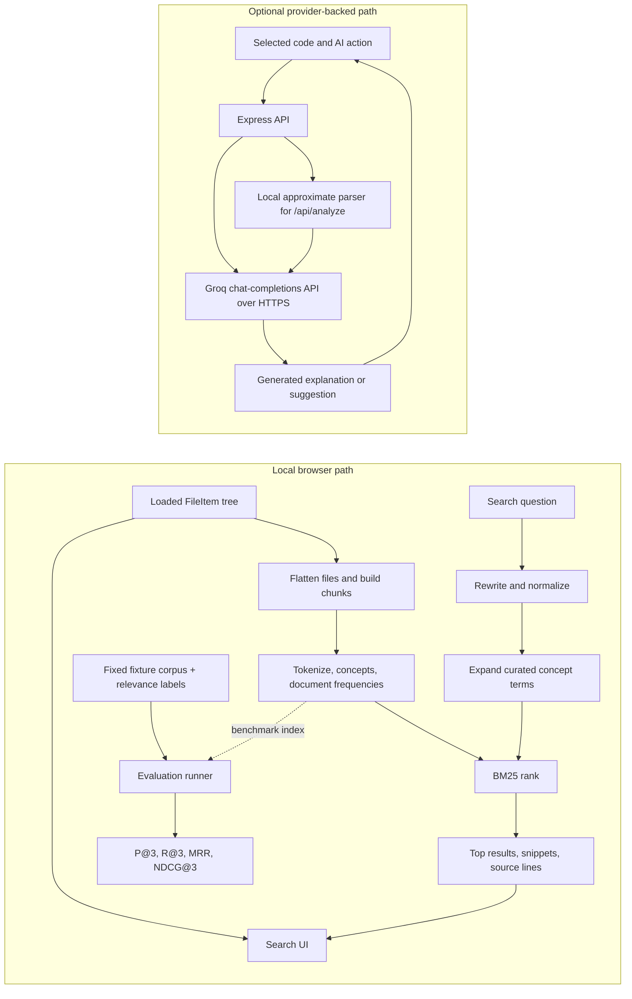

# CodeExplain

CodeExplain is an interactive code workbench that addresses two related problems: finding the right code or project documentation from an intent-based question, and understanding a selected file without confusing approximate local analysis with compiler facts. It combines a **local, deterministic lexical retrieval and evaluation system** with a **separate, optional Groq-backed code-assistance layer**.

The retrieval contribution is a complete system, not just a search box: it normalizes queries, expands a curated programming-concept vocabulary, chunks code and documentation, ranks chunks with BM25, returns source locations, and measures ranking against explicit relevance judgments. Search and its benchmark run in the browser without an API key or provider call. The optional provider path adds generated explanations and code suggestions; it is not part of the retrieval score.


## Problem and measurable objectives

Exact filename or keyword lookup is a poor fit for questions such as “where is input validated?” Codebases also mix source files and human-written setup or design documents. CodeExplain implements these measurable objectives:

1. Index supported in-memory project files into searchable code and documentation chunks.
2. Return up to eight positively scored results with file path, chunk label, matched query terms, snippet, and 1-based source-line range; allow opening a result at its starting line.
3. Keep retrieval, concept suggestions, and benchmark execution local and independent of provider credentials.
4. Make retrieval changes measurable with a fixed, checked-in benchmark and standard ranking metrics.

The benchmark currently covers six fixture files, twelve indexed chunks, and eleven queries at a default cutoff of three. Its measured values are reported below; these fixtures do not establish general accuracy on arbitrary repositories.

## Contributions

| Contribution | Implementation |
|---|---|
| Local code-and-document retrieval: query rewriting, concept expansion, chunk construction, BM25 ranking, content filters, and deterministic suggestions. | [`searchEngine.ts`](./src/features/search/searchEngine.ts), [`ProjectSearch.tsx`](./src/features/search/ProjectSearch.tsx) |
| A reproducible fixture benchmark with explicit relevant chunk IDs and per-query plus aggregate retrieval metrics. | [`searchEvaluation.ts`](./src/features/search/searchEvaluation.ts), [`SearchEvaluationPanel.tsx`](./src/features/search/SearchEvaluationPanel.tsx) |
| Behavioral tests for ranking, line locations, query rewriting, suggestions, code/document filtering, and evaluation validation. | [`searchEngine.test.ts`](./src/features/search/searchEngine.test.ts), [`searchEvaluation.test.ts`](./src/features/search/searchEvaluation.test.ts) |
| A lightweight local parser for approximate language detection, symbols, and code metrics, combined with provider-generated analysis when requested. | [`parser.ts`](./src/services/parser.ts), [`groq.ts`](./src/services/groq.ts), [`server.ts`](./server.ts) |

## Architecture and data flow



In the local path, the search UI receives the loaded `FileItem[]`, builds an index, searches it synchronously, and opens a result using its file path and starting line. The benchmark independently builds an index from its own fixed fixture files; it does not score the currently loaded repository or the provider's output. In the optional path, Express accepts an AI action and the Groq service sends prompts and relevant code to Groq. `/api/analyze` first computes approximate local metrics and includes them in the provider prompt, then returns the provider report together with local parser data.

## Retrieval pipeline

### Tokenization and normalization

`searchEngine.ts` lowercases text, separates lower-to-upper camelCase boundaries, and extracts `[a-z][a-z0-9]*` tokens. It applies simple suffix rules (`ing`, `ed`, `ies`, then plural `s`) and removes a fixed stop-word list and one-character tokens. Query rewriting also removes a separate set of question/filler words and deduplicates the remainder. These are deterministic lexical rules, not a learned language model or semantic embeddings.

### Concept vocabulary

Seven curated groups relate exact vocabulary within input validation, error handling, authentication, caching, sorting, testing, and parsing. Query expansion adds the group's terms when a normalized query term equals an alias or, for query terms of at least four characters, shares its first four characters with an alias. Suggestions are generated locally from the same groups and capped at three. The vocabulary supplies a small, inspectable synonym bridge; it does not infer arbitrary semantic similarity.

### Chunking

- **Code declarations:** recognize a fixed set of declaration keywords using a line regular expression, including `def`, `function`, `class`, `interface`, `struct`, `enum`, `type`, `const`, `let`, and `var`. A declaration chunk ends at the next declaration with indentation no deeper than its start, or at a maximum of 79 lines. This is declaration-oriented text chunking, not AST parsing.
- **Code without recognized declarations:** use 60-line chunks with 10 lines of overlap (a 50-line stride).
- **Markdown-like documentation (`.md`, `.mdx`, `.rst`, `.txt`):** split at Markdown headings; divide long sections into 60-line chunks. If there are no headings, chunk the whole file in 60-line pieces.
- Every result retains a file path and 1-based start/end line numbers. Snippets show at most the first eight lines of a chunk.

Other non-directory files are treated as code by the search index. The extension list above describes documentation classification, not a claim that every programming language has a dedicated parser.

### BM25 scoring

For each normalized query term \(t\) that appears in a chunk \(d\), the implementation adds:

\[
\operatorname{score}(d,q)=\sum_{t\in q\cap d}
\underbrace{\ln\left(1+\frac{N-\operatorname{df}(t)+0.5}{\operatorname{df}(t)+0.5}\right)}_{\operatorname{IDF}(t)}
\cdot
\frac{f(t,d)(k_1+1)}
{f(t,d)+k_1\left(1-b+b\frac{|d|}{\operatorname{avgdl}}\right)}
\]

Here, \(N\) is the number of indexed chunks, \(\operatorname{df}(t)\) is the number of chunks containing \(t\), \(f(t,d)\) is its frequency in the chunk, \(|d|\) is the token count of the indexed text (file path, chunk label, and chunk content), and \(\operatorname{avgdl}\) is average indexed-text length. The code fixes \(k_1=1.2\), \(b=0.75\), and \(k_1+1=2.2\). It scores the deduplicated expanded query terms, drops zero-score chunks, sorts descending by score (then file path), and returns at most eight results in the UI.

**Worked example (illustrative, not a measured corpus result):** take \(N=4\), \(\operatorname{df}(t)=1\), \(f(t,d)=2\), \(|d|=20\), and \(\operatorname{avgdl}=40\). Then
\[
\operatorname{IDF}=\ln(1+3.5/1.5)\approx1.204,\quad
\operatorname{lengthNorm}=1.2(1-0.75+0.75\cdot0.5)=0.75,
\]
\[
\operatorname{TFNorm}=\frac{2\cdot2.2}{2+0.75}=1.6,\quad
\operatorname{contribution}\approx1.204\cdot1.6=1.926.
\]
For a one-term query, this is the chunk's score. A real result score depends on the full index and all matching query terms.

## Evaluation methodology and results

The benchmark in `searchEvaluation.ts` creates six small source/documentation fixtures and eleven query cases. Each case lists the expected relevant `filePath::symbol` identifier directly in source. It evaluates the local BM25 ranking at \(k=3\); the React Eval panel invokes the same runner. The suite is reproducible and its fixed relevance labels are intended for regression detection and ranking verification, not as a representative sample of real repositories. **The code proves that labels are explicit and fixed, but cannot prove who assigned them; confirm they were human-judged before describing this as a human-labeled benchmark in the viva.** AI-generated query expansions are not included in the benchmark score.

For each query, let \(R\) be the number of labeled relevant chunks and \(r\) be the number retrieved within the first \(k\):

- \(\mathrm{Precision@k}=r/k\).
- \(\mathrm{Recall@k}=r/R\).
- \(\mathrm{RR}=1/\text{rank of first relevant result}\), or 0 if none is retrieved; \(\mathrm{MRR}\) is the mean RR across queries.
- With binary relevance, \(\mathrm{DCG@k}=\sum_{i=1}^{k} rel_i/\log_2(i+1)\); \(\mathrm{NDCG@k}=\mathrm{DCG@k}/\mathrm{IDCG@k}\), where IDCG ranks up to \(\min(R,k)\) relevant items first.

**Measured by running `runSearchEvaluation()` and `npm test` in this checkout:**

| Corpus files | Indexed chunks | Queries | Precision@3 | Recall@3 | MRR | NDCG@3 |
|---:|---:|---:|---:|---:|---:|---:|
| 6 | 12 | 11 | 0.333 | 1.000 | 0.909 | 0.933 |

Each current query has one labeled relevant chunk, so Precision@3 is one-third when that item is found in the top three; it is not a statement that two-thirds of retrieved items are wrong across production use. The automated test asserts Recall@3 and MRR are each at least 0.7, along with metric bounds; it does not assert the displayed aggregate values exactly. Re-run `npm test` after retrieval changes and use the Eval panel to inspect per-query ranking. The extension plan is to add more human-judged queries and repositories, multiple relevant items, and hard negatives before comparing parameter settings or retrieval systems.

## Design decisions and scope

| Choice | Rationale and trade-off | Alternative considered | Planned extension |
|---|---|---|---|
| BM25 over lexical terms | Local, deterministic, explainable scores need no model download, key, or network. Curated aliases make a few domain relations explicit. | Embedding/vector retrieval can match paraphrases beyond vocabulary but adds a model, indexing cost, and evaluation requirements. | Expand the judged benchmark first; then compare a hybrid lexical/vector ranker against this baseline. |
| Declaration-oriented bounded chunks | Search results identify a named code region and line range without requiring a compiler for each language. Regex boundaries are inexpensive but incomplete. | Language-specific AST parsing gives stronger syntactic boundaries at the cost of parser dependencies and language coverage work. | Add AST-backed chunking behind a parser interface for selected languages, retaining a bounded-text fallback. |
| Lightweight parser and heuristic metrics | The app can show a quick local structural estimate without a compiler or external service. Pattern matching does not provide compiler-grade ASTs or reliable static analysis. | Compiler frontends or established parser libraries provide more accurate syntax and control-flow models but introduce language/toolchain dependencies. | Add syntax-derived relationships and validate metrics against language-specific fixtures. |
| Optional Groq service | Provider-backed generation adds explanations and suggestions while keeping search usable without credentials. It sends relevant code and prompts to a third party and depends on account access, network, and provider behavior. | Fully local generation avoids sending code externally but requires a local model and additional resource/runtime support. | Keep provider use explicit; improve output validation and provider abstraction before adding another provider or a local model. |

## Implementation provenance

The repository source and package manifest identify files and dependencies, but do not establish who authored each project file or whether AI tools assisted. No claim that the student personally wrote—or did not use AI to generate—any listed file can be verified from these sources alone. **Complete this table from your actual workflow before the viva; do not treat repository presence as authorship evidence.**

| File(s) | What the file implements | Personal / scaffolded / adapted / AI-assisted provenance |
|---|---|---|
| [`searchEngine.ts`](./src/features/search/searchEngine.ts), [`ProjectSearch.tsx`](./src/features/search/ProjectSearch.tsx) | Local retrieval engine and search interface | [FILL IN] |
| [`searchEvaluation.ts`](./src/features/search/searchEvaluation.ts), [`SearchEvaluationPanel.tsx`](./src/features/search/SearchEvaluationPanel.tsx) | Fixed benchmark, metric calculations, and Eval interface | [FILL IN] |
| [`searchEngine.test.ts`](./src/features/search/searchEngine.test.ts), [`searchEvaluation.test.ts`](./src/features/search/searchEvaluation.test.ts) | Automated retrieval/evaluation tests | [FILL IN] |
| [`parser.ts`](./src/services/parser.ts), [`groq.ts`](./src/services/groq.ts), [`server.ts`](./server.ts) | Local heuristics, provider integration, and HTTP server | [FILL IN] |

React, Vite, TypeScript, Express, Monaco Editor, and the other runtime/build packages are declared in [`package.json`](./package.json); their library code is dependency-provided, not this project's implementation. The exact origin of any starter scaffold, copied snippets, or generated sections needs to be recorded by the project author rather than inferred here.

## Privacy, cost, and security

- **Local path:** project search, query suggestions, concept extraction, and benchmark execution use local JavaScript functions over the supplied file data. They do not call Groq and need no API key.
- **Provider path:** when an AI action is invoked, relevant source code and prompts are sent by the server to Groq's chat-completions endpoint over HTTPS. `/api/analyze` sends the code and local metrics; chat includes selected code, the latest question, and up to six history messages (with per-message truncation). Do not send secrets or code you are not authorized to share.
- **Credential handling:** configure `GROQ_API_KEY` in the server environment or root `.env`; keep `.env` out of version control. `GROQ_MODEL` optionally overrides the default `openai/gpt-oss-120b`. Usage, quotas, and cost are controlled by Groq and your account; this repository does not calculate or guarantee provider charges.
- **Deployment boundary:** the Express server listens on `0.0.0.0:3000`, accepts JSON and URL-encoded bodies up to 20 MB, and the inspected server has no request authentication or rate limiter. Do not expose it as a public service without adding appropriate access controls, abuse limits, and deployment configuration. Generated analysis, refactoring, tests, and complexity claims require human review.

## Setup and usage

### Requirements

Install Node.js and npm. `package.json` does not declare a tested Node version range. A Groq API key is optional and is only needed for provider-backed actions.

### Install and run locally

```powershell
git clone https://github.com/srishtipandey1/codeexplain.git
Set-Location .\codeexplain
npm install
npm run dev
```

Open [http://localhost:3000](http://localhost:3000), choose **Start exploring**, then use the **Search** tab for local project retrieval or **Eval** to inspect the fixed benchmark. Search works without `.env` or a Groq key.

To enable provider-backed actions, copy the example and add your key:

```powershell
Copy-Item .env.example .env
```

Set `GROQ_API_KEY` in `.env`; optionally set `GROQ_MODEL`. Never commit `.env`.

### Commands

| Command | Effect |
|---|---|
| `npm run dev` | Run Express with Vite development middleware on port 3000. |
| `npm test` | Run the search engine and evaluation tests with Node's test runner through `tsx`. |
| `npm run lint` | Run `tsc --noEmit` (TypeScript check). |
| `npm run build` | Build the Vite frontend and bundle the production server to `dist/server.cjs`. |
| `npm run start` | Run the production server; run `npm run build` first. |

The current checkout passed all ten tests, `npm run lint`, and `npm run build`. The production build reports a Vite warning that the minified JavaScript chunk exceeds 500 kB; the build still succeeds.

## Future work (ordered)

1. **Broaden evaluation first:** grow the human-judged query set across real target repositories, record multiple relevant chunks and hard negatives, and preserve the current benchmark as a regression baseline. This addresses the fixture benchmark's limited generalizability.
2. **Improve code boundaries and relationships:** add AST-backed chunking and derive call/dependency edges from syntax. This addresses declaration-regex and lightweight-parser limitations.
3. **Compare retrieval methods:** tune BM25 only against judged cases, then test optional hybrid/vector retrieval against the lexical baseline. This preserves measurable comparison rather than replacing an explainable system on intuition.
4. **Harden optional provider deployment:** validate provider output at runtime, add authentication and rate limiting, and make deployment network exposure configurable. This follows from the current provider and server boundaries.
5. **Record provenance and license:** document per-file authorship/tool assistance and add a license only after the project owner selects one.

## Glossary

| Term | Meaning in this project |
|---|---|
| BM25 | Lexical ranking function using term frequency, inverse document frequency, and document-length normalization. |
| Chunk | Indexed code declaration/text window or documentation section with source line boundaries. |
| `df(t)` | Number of indexed chunks containing term \(t\). |
| IDCG / NDCG | Ideal discounted cumulative gain / normalized discounted cumulative gain; rank-sensitive relevance metrics. |
| MRR | Mean reciprocal rank of the first relevant result across benchmark queries. |
| Precision@k / Recall@k | Relevant retrieved items divided by \(k\) / relevant retrieved items divided by all labeled relevant items. |
| Local | Executed in the browser from supplied file contents, without a provider request. |

## License

No `LICENSE` file is present in this repository. No open-source reuse or redistribution license is asserted here. The project owner should choose and add a license before granting reuse rights.
