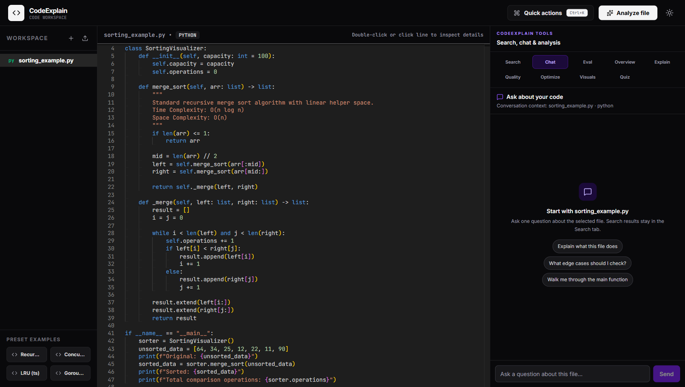
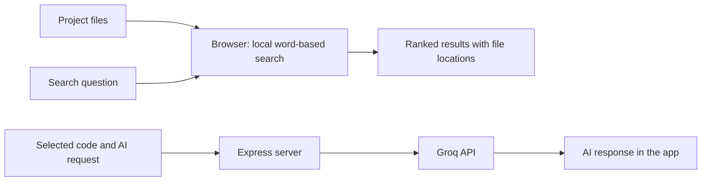

# CodeExplain

CodeExplain is a web app for finding code and project documentation by describing what you want to locate. Search runs locally; optional code-assistance actions use the Groq API.



## Project overview

CodeExplain helps developers navigate a loaded project by searching code and documentation with a natural-language question. It presents ranked matches with a file path, a named section, a short excerpt, and source-line locations. Users can inspect the selected code in the editor and optionally request provider-backed assistance.

The application separates two workloads:

- **Local retrieval and evaluation:** Project search, concept suggestions, and the fixed benchmark run in the browser. They require no API key and do not send project files to Groq.
- **Optional code assistance:** The browser sends the requested action and relevant code to the Express server. The server builds a prompt and calls Groq's chat-completions API.

This separation keeps the search workflow available independently of the external model provider. Search is lexical: basic text processing and curated aliases help connect related wording, while BM25 ranks term matches. It is not embedding-based or language-model search.

## Architecture and data flow



The browser builds an in-memory search index from the loaded file tree. Search questions are normalized and expanded, then compared with indexed sections. The UI displays matching sections and their original locations. The evaluation runner uses its own small fixture corpus and relevance labels; it does not call the provider.

For AI actions, the browser posts a request to an Express endpoint. The server prepares action-specific input and calls the Groq API. For code analysis, it also calculates local structural estimates and includes them with the generated report. The application does not use a project database.

## Main features

- Search code and documentation with a natural-language question.
- Filter results by code, documentation, or both.
- Open a result at its source location.
- Run a small fixed search benchmark in the Eval panel.
- Optionally ask for code explanations, quizzes, refactoring suggestions, tests, and other code assistance through Groq.

## Local retrieval pipeline

### 1. File classification and chunking

The indexer flattens the loaded file tree and skips empty files and directories. Markdown, MDX, reStructuredText, and plain-text files are treated as documentation; other non-directory files are treated as code.

For code, a line-based declaration pattern recognizes common names introduced by keywords such as `function`, `class`, `def`, `interface`, `type`, `const`, and `let`. A declaration starts a named chunk that continues until the next declaration at the same or shallower indentation, or until the 79-line limit. Code files without a recognized declaration are divided into windows of up to 60 lines with 10 lines of overlap.

Documentation is split at Markdown headings and into sections of up to 60 lines. Each indexed chunk retains its file path, kind, symbol or heading label, and 1-based line range. The result snippet shows up to the first eight lines.

### 2. Lightweight text processing

The tokenizer separates camelCase boundaries, lowercases text, and extracts word-like tokens. It applies simple suffix rules to common endings, removes a fixed stop-word list and one-character tokens, and deduplicates query terms. Query rewriting also removes a small set of filler words.

Seven curated concept groups cover input validation, error handling, authentication, caching, sorting, testing, and parsing. When a query term matches an alias—or shares its first four characters with an alias when it is at least four characters long—the corresponding group terms are added to the query. These rules improve matching for selected vocabulary; they do not infer general semantic similarity.

### 3. BM25 ranking

The index stores normalized terms for each chunk and counts how many chunks contain each term. Search scores each unique expanded query term that is present in a chunk. The BM25 score uses term frequency, inverse document frequency, and chunk-length normalization. Its fixed parameters are `k1 = 1.2` and `b = 0.75`.

The searchable text for a chunk includes its file path, label, and contents. Consequently, a match may come from its name or location as well as from its code or documentation. Zero-score chunks are removed. Results are ordered by descending score, with file path as the tie-breaker, and the interface shows up to eight results.

## Evaluation

The Eval panel runs a deterministic benchmark using six fixture files, twelve indexed chunks, and eleven queries. Each query has a fixed relevant `filePath::symbol` label, and the default cutoff is the first three results. The metrics summarize the ranking of those labeled targets:

| Metric | What it measures |
|---|---|
| Precision@3 | Fraction of the first three results that are labeled relevant. |
| Recall@3 | Fraction of labeled relevant results found in the first three. |
| MRR | Average reciprocal rank of the first relevant result across queries. |
| NDCG@3 | Ranking quality in the first three positions relative to an ideal ordering. |

Current results on the included fixtures:

| Corpus files | Indexed chunks | Queries | Precision@3 | Recall@3 | MRR | NDCG@3 |
|---:|---:|---:|---:|---:|---:|---:|
| 6 | 12 | 11 | 0.333 | 1.000 | 0.909 | 0.933 |

Each query currently has one labeled relevant chunk. This small fixed benchmark supports repeatable checks of expected retrieval behavior; it is not a measurement across arbitrary repositories. The search and evaluation implementations have automated tests.

## Technology and dependencies

| Package or service | Role |
|---|---|
| React (`react`, `react-dom`) | Browser application and UI |
| TypeScript | Application language and type checking |
| Vite | Frontend development server and build |
| Express | HTTP endpoints for optional AI actions |
| `@monaco-editor/react` | Code editor |
| Tailwind CSS | UI styling |
| Groq API | External provider for generated assistance |

Groq is an external service rather than an installed npm package. The application makes HTTPS requests to its chat-completions endpoint. There is no project database.

## Requirements and configuration

- Node.js and npm are required to install, run, and build the application.
- `GROQ_API_KEY` is optional and is required only for provider-backed actions.
- `GROQ_MODEL` optionally selects the model. The configured default is `openai/gpt-oss-120b`.

Local search, suggestions, and evaluation do not require a Groq key. Provider-backed actions send their relevant code and prompt to Groq; do not use them with source material that must stay local.

## Setup and usage

Install Node.js and npm. A Groq API key is optional and is needed only for AI actions.

### Install and run

```powershell
git clone https://github.com/srishtipandey1/codeexplain.git
Set-Location .\codeexplain
npm install
npm run dev
```

Open [http://localhost:3000](http://localhost:3000), choose **Start exploring**, then use **Search** for local project retrieval or **Eval** to inspect the benchmark.

To configure provider-backed actions, copy `.env.example` to `.env` and set `GROQ_API_KEY`. Set `GROQ_MODEL` to override the default model.

```powershell
Copy-Item .env.example .env
```

### Commands

| Command | Effect |
|---|---|
| `npm run dev` | Run Express with Vite development middleware on port 3000. |
| `npm test` | Run search-engine and retrieval-evaluation tests with Node's test runner through `tsx`. |
| `npm run lint` | Run `tsc --noEmit`. |
| `npm run build` | Build the Vite frontend and bundle the production server to `dist/server.cjs`. |
| `npm run start` | Run the production server after `npm run build`. |

### HTTP endpoints

The Express server exposes these actions:

| Method and route | Purpose |
|---|---|
| `GET /api/health` | Check server health. |
| `POST /api/analyze` | Return provider-generated analysis alongside local parser estimates. |
| `POST /api/chat` | Ask a question about selected code. |
| `POST /api/quiz` | Generate code-based quiz questions. |
| `POST /api/optimize` | Generate optimization suggestions. |
| `POST /api/refactor` | Generate a refactored version and summary. |
| `POST /api/complexity` | Generate complexity analysis. |
| `POST /api/flowchart` | Generate a Mermaid flowchart. |
| `POST /api/tests` | Generate candidate tests. |

## Scope and design choices

- **Word-based retrieval:** BM25 offers local ranking with inspectable term matches and no external service call. The trade-off is that queries using unrelated wording may not find conceptually similar code.
- **Line-based chunking:** Declaration and heading boundaries provide readable results with source locations without requiring a compiler. The approach is lightweight but is not a full syntax parser.
- **Curated concept aliases:** A small vocabulary makes selected programming concepts searchable under related terms. Alias coverage is intentionally limited to the defined groups.
- **Optional provider integration:** Groq powers generated explanations and code actions, while search and evaluation remain available without a provider key. Provider output is generated text and should be reviewed before use.

## License

This project is licensed under the MIT License. See [LICENSE](./LICENSE).
