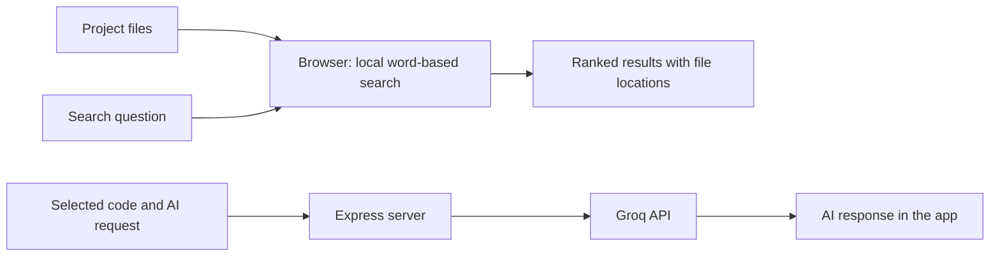

# CodeExplain

CodeExplain is a web app for finding code and project documentation by describing what you want to locate. Search runs locally; optional code-assistance actions use the Groq API.


## What the project does

CodeExplain helps developers locate relevant code and project documentation by describing what they are looking for. Search results show a short excerpt and where it appears in the project.

The project has two separate paths:

1. **Local search:** Loaded files are organized into searchable sections and ranked using BM25, a word-based ranking method. This path does not call an AI model and does not require an API key.
2. **Optional AI assistance:** Code-related actions send the selected code and prompt from the app to the Express server, which calls Groq and returns a generated response.

Search accepts natural-language questions, then uses lightweight text processing to compare normalized words and selected programming-term aliases. It does not use a language model or understand meaning the way a person does.

## Architecture



The search index and evaluation run in the browser. The Express server is used for optional AI actions. There is no project database. The local parser calculates structural code estimates for analysis actions.

## Main features

- Search code and documentation with a natural-language question.
- Filter results by code, documentation, or both.
- Open a result at its source location.
- Run a small fixed search benchmark in the Eval panel.
- Optionally ask for code explanations, quizzes, refactoring suggestions, tests, and other code assistance through Groq.

## Search and evaluation

### Lightweight NLP-style text processing

The search uses a few basic natural-language processing steps rather than an AI model: it lowercases words, separates camelCase words, normalizes some common word endings, and removes common filler words from queries. A small set of curated programming-term aliases can add related search terms. These steps help match wording variations, but search remains word-based and does not infer the intent or meaning of code.

### Ranking and evaluation

After text processing, search breaks files into sections and ranks matching sections with BM25. Results include the file path, a short excerpt, and line numbers.

The Eval panel runs a fixed benchmark made from six fixture files, twelve indexed sections, and eleven labeled queries. It reports ranking scores to show whether expected results appear near the top. Automated tests cover the search and evaluation code.

## Technology and dependencies

| Main package | Role |
|---|---|
| `react`, `react-dom` | User interface |
| `express` | Server for optional AI actions |
| `vite`, `typescript` | Development and build |
| `@monaco-editor/react` | Code editor interface |
| `tailwindcss` | UI styling |

Groq is an external service, not an installed npm package. Requests use its chat-completions HTTP API. The application has no database dependency.

## Requirements and model

- Node.js and npm to install, run, and build the project.
- A Groq API key is optional and is needed only for provider-backed AI actions.
- The default Groq model is `openai/gpt-oss-120b`. Set `GROQ_MODEL` to use a different model available to the Groq account.

Local search and evaluation do not require a Groq key. AI actions send the relevant code and prompt to Groq, so avoid sending code that should remain private.

## Simple viva overview

**What problem does CodeExplain address?**

It helps users find relevant code and documentation without knowing the exact filename.

**How does search work?**

It applies basic text cleanup to the question, compares its words with words in project sections, then ranks matching sections using BM25. BM25 considers matching-word frequency and section length.

**What does NLP mean in this project?**

It means basic text cleanup and query-term matching, such as handling capitalization and common word endings. It does not mean that search uses an AI model or understands the code's meaning.

**Does search use AI?**

No. Search and evaluation run locally. Groq is used only when an optional AI action is selected.

**What model does the AI feature use?**

It uses `openai/gpt-oss-120b` through Groq by default. Set `GROQ_MODEL` to select another model available to the account.

**What is sent to Groq?**

The selected code and prompt needed for the requested AI action. Ordinary local search does not send files to Groq.

**What are the main limitations?**

Word-based search may miss relevant code when the question uses very different wording. AI responses can be inaccurate and should be reviewed.

## Setup and usage

Install Node.js and npm. A Groq API key is optional and is needed only for AI actions.

### Install and run

```powershell
git clone https://github.com/srishtipandey1/codeexplain.git
Set-Location .\codeexplain
npm install
npm run dev
```

Open [http://localhost:3000](http://localhost:3000), choose **Start exploring**, then use **Search** for local project retrieval or **Eval** to inspect the benchmark.

To configure provider-backed actions, copy `.env.example` to `.env` and set `GROQ_API_KEY`. Set `GROQ_MODEL` to override the default model.

```powershell
Copy-Item .env.example .env
```

### Commands

| Command | Effect |
|---|---|
| `npm run dev` | Run Express with Vite development middleware on port 3000. |
| `npm test` | Run search-engine and retrieval-evaluation tests with Node's test runner through `tsx`. |
| `npm run lint` | Run `tsc --noEmit`. |
| `npm run build` | Build the Vite frontend and bundle the production server to `dist/server.cjs`. |
| `npm run start` | Run the production server after `npm run build`. |

## License

This project is licensed under the MIT License. See [LICENSE](./LICENSE).
