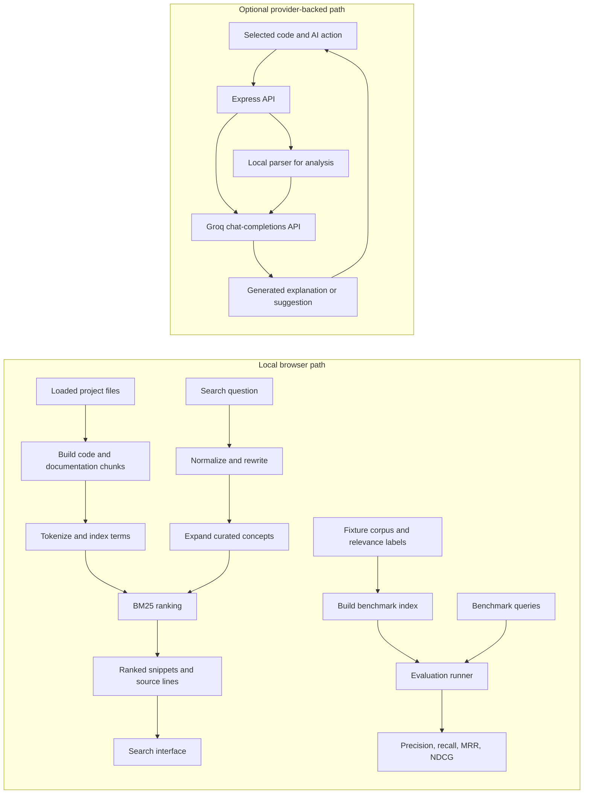

# CodeExplain

CodeExplain is an interactive code workbench for finding relevant code and project documentation from natural-language questions, then exploring selected code with structural summaries and optional AI assistance. We combine a **local, deterministic lexical retrieval system and reproducible evaluation framework** with a **separate, optional Groq-backed generation layer**.

The retrieval system normalizes queries, expands a curated programming-concept vocabulary, chunks code and documentation, ranks chunks with BM25, returns source locations, and evaluates rankings against fixed relevance labels. Search, suggestions, and evaluation run locally in the browser without provider credentials.


## Problem and objectives

Finding code by exact filename or keyword can be difficult when a question describes intent, such as “where is input validated?” Project code also sits alongside documentation for setup, deployment, and design. CodeExplain brings both sources into one local retrieval workflow.

Our objectives are to:

1. Index loaded project files as searchable code and documentation chunks.
2. Return up to eight ranked results with file path, chunk label, matched terms, snippet, and source-line range.
3. Let users filter by code, documentation, or both, and open a result at its source line.
4. Run retrieval and evaluation without an API key or external service.
5. Track ranking behavior with a fixed benchmark and standard retrieval metrics.

## System components

| Component | Implementation |
|---|---|
| Local code-and-document retrieval, query rewriting, concept expansion, chunk construction, BM25 ranking, and deterministic suggestions | [`searchEngine.ts`](./src/features/search/searchEngine.ts), [`ProjectSearch.tsx`](./src/features/search/ProjectSearch.tsx) |
| Fixed benchmark, metric calculations, and evaluation interface | [`searchEvaluation.ts`](./src/features/search/searchEvaluation.ts), [`SearchEvaluationPanel.tsx`](./src/features/search/SearchEvaluationPanel.tsx) |
| Automated retrieval and evaluation tests | [`searchEngine.test.ts`](./src/features/search/searchEngine.test.ts), [`searchEvaluation.test.ts`](./src/features/search/searchEvaluation.test.ts) |
| Local structural estimates, provider-backed code assistance, and HTTP endpoints | [`parser.ts`](./src/services/parser.ts), [`groq.ts`](./src/services/groq.ts), [`server.ts`](./server.ts) |

## Architecture and data flow



In the local path, the search interface builds an index from the loaded file tree, searches it synchronously, and opens a result using its file path and starting line. The benchmark builds a separate index from its fixed fixtures. It evaluates the local BM25 ranking and does not include provider-generated output.

In the optional path, Express receives an AI action and the Groq service sends prompts and relevant code to Groq. For `/api/analyze`, the server first computes local parser data, includes local metrics in the provider prompt, and returns the generated report together with the local structural data.

## Retrieval pipeline

### Tokenization and normalization

We lowercase text, separate lower-to-upper camelCase boundaries, and extract `[a-z][a-z0-9]*` tokens. Normalization applies simple suffix rules (`ing`, `ed`, `ies`, then plural `s`), removes a fixed stop-word list and one-character tokens, removes question/filler words from queries, and deduplicates query terms.

### Concept vocabulary

Seven curated groups cover input validation, error handling, authentication, caching, sorting, testing, and parsing. Query expansion adds group terms when a normalized query term equals an alias or, for query terms of at least four characters, shares its first four characters with an alias. Local suggestions use the same groups and return at most three terms.

### Chunking

- **Code declarations:** a line-based declaration pattern recognizes keywords including `def`, `function`, `class`, `interface`, `struct`, `enum`, `type`, `const`, `let`, and `var`. A declaration chunk ends at the next declaration with indentation no deeper than its start, or at 79 lines.
- **Code without recognized declarations:** chunks contain up to 60 lines with 10 lines of overlap, producing a 50-line stride.
- **Documentation:** `.md`, `.mdx`, `.rst`, and `.txt` files are split at Markdown headings and into 60-line chunks for long sections. Files without headings are divided into 60-line chunks.
- Results preserve the file path and 1-based start and end lines. A snippet displays up to the first eight lines of its chunk.

Other non-directory files are indexed as code.

### BM25 scoring

For each normalized query term that appears in a chunk, the ranker adds:

```
score(chunk, query) = sum over each query term t found in the chunk of
IDF(t) * TF(t)

IDF(t) = ln( 1 + (N - df + 0.5) / (df + 0.5) )
TF(t)  = f * (k1 + 1) / ( f + k1 * (1 - b + b * len / avglen) )
```

score = BM25 relevance score for this chunk and query
chunk = one indexed code or documentation chunk
query = normalized and expanded search terms
t = one query term that appears in the chunk
IDF(t) = inverse document frequency of the term
TF(t) = length-normalized frequency of the term in this chunk
N = total number of chunks in the index
df = number of chunks that contain the term
f = number of times the term appears in this chunk
len = length of this chunk in tokens
avglen = average chunk length across the index
k1 = 1.2 (limits how much repeated terms help)
b = 0.75 (controls how much long chunks are penalized)

The indexed text includes the file path, chunk label, and chunk content. The ranker scores deduplicated expanded query terms, removes zero-score chunks, sorts by descending score with file path as the tie-breaker, and the interface displays up to eight results.

**Worked example:** for N = 4, df = 1, f = 2, len = 20, and avglen = 40:

```
IDF = ln(1 + (4 - 1 + 0.5) / (1 + 0.5)) = ln(3.33) = about 1.204
TF  = 2 * 2.2 / (2 + 1.2 * (1 - 0.75 + 0.75 * 0.5)) = 4.4 / 2.75 = 1.6
Contribution of this term = 1.204 * 1.6 = about 1.926
```

For a one-term query, the chunk score is approximately 1.926.

## Evaluation methodology and results

The benchmark uses six code and documentation fixture files, twelve indexed chunks, and eleven queries. Each query has a fixed relevant `filePath::symbol` target. The runner evaluates rankings at k = 3 and reports per-query metrics and their averages. The Eval panel displays aggregate scores and individual query ranks.

For each query, Precision@3, Recall@3, and NDCG@3 use the first three results. Reciprocal rank uses the rank of the first relevant result:

```
Precision@3 = relevant results in the first 3 / 3
Recall@3 = relevant results in the first 3 / total relevant results
RR = 1 / rank of the first relevant result, or 0 if none is retrieved
MRR = sum of RR across all queries / number of queries
DCG@3 = rel(1) + rel(2) * ln(2) / ln(3) + rel(3) * ln(2) / ln(4)
IDCG@3 = idealRel(1) + idealRel(2) * ln(2) / ln(3) + idealRel(3) * ln(2) / ln(4)
NDCG@3 = DCG@3 / IDCG@3
```

Variable key: relevant results = retrieved chunks with a fixed relevant label; total relevant results = all chunks labeled relevant for this query; rank = position of the first relevant result, starting at 1; RR = reciprocal rank for one query; i = result position from 1 to 3; rel(i) = 1 if the result at rank i is relevant, otherwise 0; idealRel(i) = 1 if rank i contains a relevant result in the ideal ranking, otherwise 0; DCG@3 = discounted cumulative gain at rank 3; IDCG@3 = DCG@3 for the ideal ranking, with relevant results placed first; NDCG@3 = DCG@3 divided by IDCG@3.

| Corpus files | Indexed chunks | Queries | Precision@3 | Recall@3 | MRR | NDCG@3 |
|---:|---:|---:|---:|---:|---:|---:|
| 6 | 12 | 11 | 0.333 | 1.000 | 0.909 | 0.933 |

Each benchmark query has one relevant chunk. The fixture corpus exercises code search, documentation search, query rewriting, and ranking at the top three positions.
The benchmark provides a reproducible regression check and a way to verify ranking behavior across its fixed fixtures.

## Design decisions

| Choice | Rationale | Alternative considered | Planned extension |
|---|---|---|---|
| BM25 over lexical terms | Local ranking is deterministic and its term contributions are inspectable. Curated aliases make selected programming concepts searchable under related wording. | Embedding-based retrieval | Compare hybrid lexical and vector ranking against BM25 using a larger judged benchmark. |
| Declaration-oriented bounded chunks | Named chunks retain a useful symbol label and source-line range without requiring a compiler for each language. | Language-specific AST chunking | Add AST-backed chunking for selected languages while retaining text chunking for other files. |
| Lightweight local parser | Rule-based estimates are available without invoking a compiler or external provider. | Compiler frontends or established language parsers | Derive symbols, metrics, and relationships from syntax and validate them with language-specific fixtures. |
| Optional Groq service | Provider-backed generation adds explanations and code suggestions while local search remains independently usable. | Fully local generation or another provider | Keep provider use explicit, validate generated output, and compare provider or local-model options. |

## Privacy, cost, and security

- Project search, concept suggestions, and benchmark evaluation run locally in the browser.
- Provider-backed actions send relevant source code and prompts to Groq's chat-completions API over HTTPS.
- `/api/analyze` sends code and locally calculated metrics. Code chat includes the selected code, the latest question, and up to six conversation-history messages, with each history message truncated by role.
- `GROQ_API_KEY` is read by the server from the environment. `GROQ_MODEL` optionally selects the model; the default is `openai/gpt-oss-120b`.
- Groq account usage, quotas, and pricing depend on the provider and account plan.
- The Express server listens on port 3000 and accepts JSON and URL-encoded bodies up to 20 MB.

## Setup and usage

### Requirements

Install Node.js and npm. A Groq API key is needed for provider-backed actions and is not required for local search or evaluation.

### Install and run

```powershell
git clone https://github.com/srishtipandey1/codeexplain.git
Set-Location .\codeexplain
npm install
npm run dev
```

Open [http://localhost:3000](http://localhost:3000), choose **Start exploring**, then use **Search** for local project retrieval or **Eval** to inspect the benchmark.

To configure provider-backed actions, copy `.env.example` to `.env` and set `GROQ_API_KEY`. Set `GROQ_MODEL` to override the default model.

```powershell
Copy-Item .env.example .env
```

### Commands

| Command | Effect |
|---|---|
| `npm run dev` | Run Express with Vite development middleware on port 3000. |
| `npm test` | Run search-engine and retrieval-evaluation tests with Node's test runner through `tsx`. |
| `npm run lint` | Run `tsc --noEmit`. |
| `npm run build` | Build the Vite frontend and bundle the production server to `dist/server.cjs`. |
| `npm run start` | Run the production server after `npm run build`. |

### API routes

| Method | Route | Description |
|---|---|---|
| `GET` | `/api/health` | Server health check. |
| `POST` | `/api/analyze` | Local structural metrics and provider-backed code analysis. |
| `POST` | `/api/chat` | Ask questions about selected code. |
| `POST` | `/api/quiz` | Generate code-based quiz questions. |
| `POST` | `/api/optimize` | Generate optimization suggestions. |
| `POST` | `/api/refactor` | Generate refactored code and a change summary. |
| `POST` | `/api/complexity` | Generate time and space complexity analysis. |
| `POST` | `/api/flowchart` | Generate a Mermaid flowchart. |
| `POST` | `/api/tests` | Generate candidate test cases. |

## Future work

1. Expand the relevance-labeled benchmark across additional repositories, queries, relevant chunks, and hard negatives.
2. Add AST-backed chunking and derive code relationships from syntax.
3. Compare BM25 parameter settings and hybrid/vector retrieval on the expanded benchmark.
4. Add runtime validation for generated responses and configurable access controls and rate limits for server deployments.
5. Add language-specific parser fixtures and validate local structural metrics against syntax-aware analysis.

## Glossary

| Term | Meaning |
|---|---|
| BM25 | Lexical ranking function using term frequency, inverse document frequency, and document-length normalization. |
| Chunk | Indexed code declaration/text window or documentation section with source-line boundaries. |
| `df(t)` | Number of indexed chunks containing term t. |
| IDCG / NDCG | Ideal discounted cumulative gain / normalized discounted cumulative gain. |
| MRR | Mean reciprocal rank of the first relevant result across benchmark queries. |
| Precision@k / Recall@k | Relevant retrieved items divided by k / relevant retrieved items divided by all labeled relevant items. |
| Local | Executed in the browser over supplied file contents, without a provider request. |

## License

This project is licensed under the MIT License. See [LICENSE](./LICENSE).
