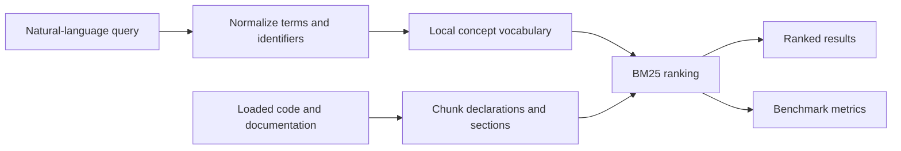
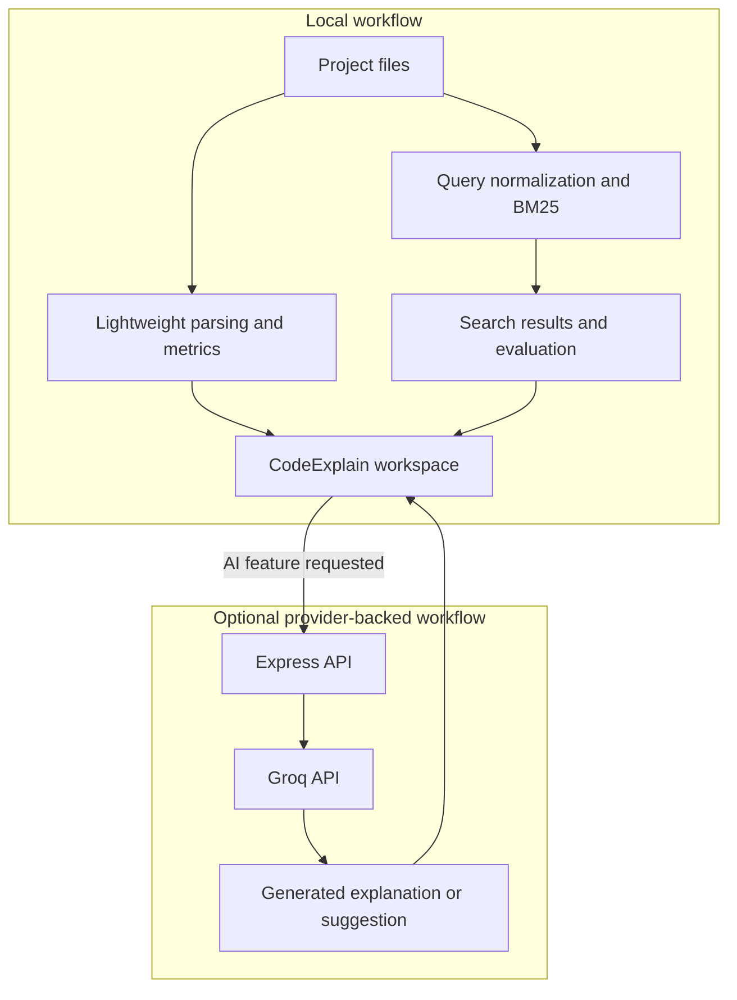

<div align="center">

# CodeExplain


The app opens on a landing page. Select **Start exploring** to enter the workspace shown here.

**Explore code. Understand its structure. Search by intent.**

An interactive code workbench with local NLP-powered project search and optional AI-assisted analysis.

[Get started](#get-started) · [Features](#features) · [NLP search](#nlp-powered-project-search) · [Privacy and costs](#privacy-and-costs)

</div>

---

## Overview

CodeExplain opens with a focused landing page; select **Start exploring** to enter the interactive workspace. Browse files, inspect extracted symbols and approximate metrics, ask questions about the selected code in the inspector's **Chat** tab, and explore explanations, quality observations, optimization ideas, visualizations, and quizzes. The **Search** tab is a separate local code-and-document search tool.

The project also includes a distinct local search and evaluation workflow. Search code and documentation with natural-language queries, inspect query normalization, and evaluate a BM25 retrieval baseline. **Search, query suggestions, and evaluation run locally and do not require an API key or send project files to an AI provider.**

## Features

- **Code workspace:** browse and edit files in a Monaco-based editor.
- **Focused entry point:** start from a product landing page and open the workspace when you are ready to explore.
- **One contextual chat:** ask questions about the selected code in the inspector's **Chat** tab. The **Search** tab finds matching files locally and is not another chatbot.
- **Code understanding:** inspect approximate metrics, symbols, and relationships.
- **Natural-language search:** retrieve relevant code and documentation with local BM25 ranking.
- **Query suggestions:** expand search terms with a deterministic, local programming-concept vocabulary.
- **Search evaluation:** measure the local baseline with a labeled benchmark and standard retrieval metrics.
- **Optional AI assistance:** request explanations, chat, quizzes, refactoring, optimization, complexity analysis, flowcharts, and candidate tests.

Generated explanations and suggestions are starting points, not authoritative results. Review them against the source code.

## NLP-powered project search

Search questions such as:

- `where is user input validated?`
- `how are errors handled?`
- `find sorting logic`
- `how do I configure deployment?`

The search index supports code and documentation files (`.md`, `.mdx`, `.rst`, and `.txt`). Filter results by code, documentation, or both, and jump from a result to its source location.

### Retrieval pipeline



1. Normalize query text with tokenization, stop-word removal, camelCase splitting, and lightweight suffix handling.
2. Relate programming terms with a small curated concept vocabulary.
3. Split code into declaration-oriented chunks and documentation into bounded sections.
4. Rank matching chunks with BM25 using term and document frequencies.

This is lexical information retrieval. The project does not currently use vector embeddings or a separately trained NLP model.

### Evaluation

The Eval panel runs a fixed, human-labeled smoke benchmark containing 11 queries and six fixture files. It reports:

| Metric | What it measures |
|---|---|
| Precision@3 | Fraction of the top three results judged relevant |
| Recall@3 | Fraction of known relevant items retrieved in the top three |
| MRR | Average reciprocal rank of the first relevant result |
| NDCG@3 | Rank-sensitive relevance score for the top three |

This small fixture benchmark is reproducible, but it is not evidence of broad real-world accuracy. More representative comparisons require a larger, carefully judged dataset. The benchmark scores the local BM25 baseline.

## Privacy and costs

### Local features

Project search, query suggestions, and evaluation run locally. They do not call Groq, require an API key, or send loaded project files to an AI provider.

### Optional provider-backed AI

The app's AI-assisted analysis, chat, quiz, refactoring, optimization, and related generation features use the Groq API. These features require a Groq API key and send the relevant code and prompts to Groq. Provider quotas and pricing depend on your account and may change; check the current terms before making requests.

Do not submit secrets, credentials, personal data, or code you are not authorized to share with the provider.

## Get started

### Requirements

- Node.js 18 or newer
- npm
- Optional: a Groq API key for provider-backed AI features

### Install and run

```bash
git clone https://github.com/srishtipandey1/codeexplain.git
cd codeexplain
npm install
npm run dev
```

Open [http://localhost:3000](http://localhost:3000). You can use local search and evaluation without configuring an API key.

### Windows PowerShell

```powershell
git clone https://github.com/srishtipandey1/codeexplain.git
Set-Location .\codeexplain
npm install
npm run dev
```

### Optional AI setup

Create a `.env` file in the project root and configure your Groq key if you want to use provider-backed features:

```env
GROQ_API_KEY=your_groq_api_key_here
GROQ_MODEL=openai/gpt-oss-120b
```

The repository includes an `.env.example` template. On Windows PowerShell, copy it with:

```powershell
Copy-Item .env.example .env
```

Replace the placeholder with your own key. Keep `.env` private and never commit API keys.

## Commands

| Command | Description |
|---|---|
| `npm run dev` | Start the development server with Vite middleware |
| `npm test` | Run project-search and retrieval-evaluation tests |
| `npm run lint` | Run the TypeScript check |
| `npm run build` | Build the frontend and production server |
| `npm run start` | Run the production server on port 3000 |

Build and run for production:

```bash
npm run build
npm run start
```

## Supported language detection

Detection is based primarily on file extensions, with a small set of content checks as a fallback. Recognition does not imply compiler-grade parsing.

| Language | Extensions |
|---|---|
| Python | `.py`, `.ipynb` |
| JavaScript | `.js`, `.jsx`, `.mjs` |
| TypeScript | `.ts`, `.tsx` |
| Java | `.java` |
| C | `.c`, `.h` |
| C++ | `.cpp`, `.cc`, `.cxx`, `.h`, `.hpp` |
| Go | `.go` |
| Rust | `.rs` |
| Kotlin | `.kt`, `.kts` |
| Swift | `.swift` |
| PHP | `.php` |
| Ruby | `.rb`, `.gemspec` |

## Architecture



The local parser estimates structure, symbols, and metrics; it is not a full compiler-grade abstract syntax tree.

### Technology

- React 19, TypeScript, and Vite 6
- Monaco Editor
- Tailwind CSS 4, Motion, and Lucide React
- Node.js and Express 4
- Local BM25 retrieval and deterministic text normalization
- Optional Groq chat-completions API

### API routes

| Method | Route | Description |
|---|---|---|
| `GET` | `/api/health` | Server health check |
| `POST` | `/api/analyze` | Local metrics and AI-assisted code analysis |
| `POST` | `/api/chat` | Ask questions about code |
| `POST` | `/api/quiz` | Generate code-based questions |
| `POST` | `/api/optimize` | Request performance suggestions |
| `POST` | `/api/refactor` | Request refactored code and a change summary |
| `POST` | `/api/complexity` | Analyze time and space complexity |
| `POST` | `/api/flowchart` | Generate a Mermaid flowchart |
| `POST` | `/api/tests` | Generate candidate test cases |

These API routes use provider-backed features and require `GROQ_API_KEY`, except for `/api/health`. Project search and evaluation run locally in the browser.

## Project structure

```text
codeexplain/
├── docs/
│   └── codeexplain-workspace.png
├── server.ts
├── vite.config.ts
├── src/
│   ├── app/
│   │   ├── App.tsx
│   │   └── WelcomePage.tsx
│   ├── components/               # File explorer, command palette, exports
│   ├── features/
│   │   ├── search/
│   │   │   ├── ProjectSearch.tsx
│   │   │   ├── SearchEvaluationPanel.tsx
│   │   │   ├── searchEngine.ts  # BM25 index and local query suggestions
│   │   │   └── searchEvaluation.ts
│   │   ├── learning/            # QuizPanel
│   │   └── visualization/       # InteractiveVisualization
│   ├── services/                 # API integration and local parsing
│   ├── types/                    # Shared TypeScript types
│   ├── main.tsx                  # React application entry point
│   └── index.css
├── .env.example
└── package.json
```

## Troubleshooting

### Local search works, but an AI feature fails

Local search does not need a key. For provider-backed features, check that `.env` is in the project root, `GROQ_API_KEY` is valid, your network can reach Groq, and your account can access the configured model.

### The app does not open on port 3000

Confirm that the server started successfully. If another process is already using port `3000`, stop that process or change the port in `server.ts`.

### Language detection looks wrong

Use a recognized file extension where possible. Content-based detection is heuristic and falls back to JavaScript when it cannot identify a language.

## Contributing

1. Install dependencies with `npm install`.
2. Run `npm test` and `npm run lint`.
3. Run `npm run build` to validate the production bundle.
4. Describe your changes and how you tested them.

Do not commit `.env` files, API keys, or other credentials.

## License

No `LICENSE` file is currently included in this repository. Check with the maintainers before reusing or distributing the project.
