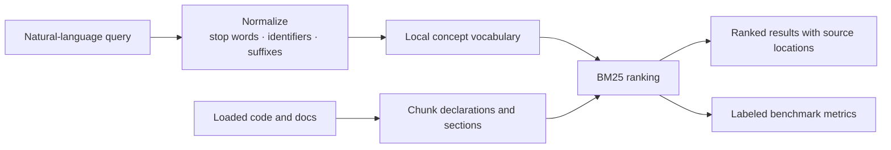
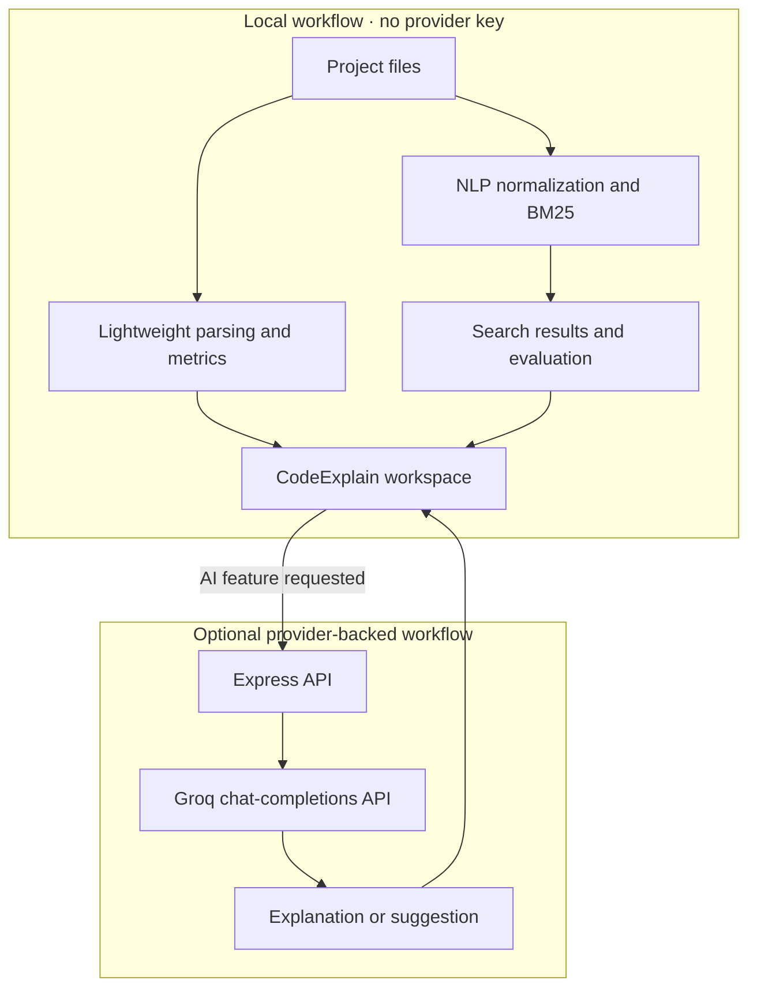

<div align="center">

# CodeExplain

### Understand code. Follow the flow. Learn by exploring.

An interactive code workbench that combines practical code analysis, optional AI explanations, and **local NLP-powered project search**.

<br />


<br />

[Get started](#-get-started) · [Explore features](#-what-you-can-do) · [Understand the NLP](#-the-nlp-search-pipeline) · [Free locally, optional AI](#-free-locally-ai-is-optional)

</div>

---

## The idea

CodeExplain helps turn an unfamiliar file into something you can reason about. Explore code in an editor, inspect its structure, ask questions in plain language, and move between explanations, quality observations, optimization ideas, visuals, and quizzes.

It also includes a distinct, **free-to-run local NLP search and evaluation workflow**. Search project code and documentation with natural-language queries, see how queries are normalized, and measure a BM25 baseline with standard information-retrieval metrics—all without sending your project to an AI provider.

> **Built to explore, not to replace your judgment.** Parsing is heuristic, and generated explanations or recommendations should always be checked against the source.

## ✨ What you can do

| Explore | Explain | Search |
|:--|:--|:--|
| Browse and edit project files in an interactive workspace. Inspect extracted symbols, relationships, and approximate code metrics. | Ask for plain-language walkthroughs, step-by-step explanations, contextual Q&A, and function-focused help. | Find code and docs by intent with local BM25 retrieval. Inspect normalized terms, browse programming concepts, and get deterministic local query suggestions. |
| **Review** possible quality issues and edge cases. | **Learn** with code-specific quizzes and explanations. | **Evaluate** the local search baseline with a labeled benchmark. |
| **Visualize** code relationships and flow. | **Improve** code with optional refactoring and optimization suggestions. | **Stay local:** search and evaluation make no AI-provider requests. |

### Search code the way you think about it

Ask questions like:

- `where is user input validated?`
- `how are errors handled?`
- `find sorting logic`
- `how do I configure deployment?`

Search covers code and project documentation (`.md`, `.mdx`, `.rst`, and `.txt`). Filter by code, docs, or both; jump from a result to its file and source location; or select a detected concept to start a focused search.

## 🧠 The NLP search pipeline

The search experience is deliberately transparent and deterministic. It uses classical information retrieval techniques rather than a hosted model:



| Stage | What happens |
|:--|:--|
| **Normalize** | Lowercase and tokenize text, split camelCase identifiers, remove common filler words, and apply lightweight suffix normalization. |
| **Connect concepts** | A small curated programming vocabulary relates terms such as *exception*, *catch*, and *failure*. Suggestions come from this local vocabulary—not from an LLM. |
| **Build the index** | Code is split into declaration-oriented chunks; Markdown is sectioned by headings, while other supported docs use bounded text chunks. |
| **Rank** | BM25 scores matching chunks using term frequency and document frequency, then returns the strongest matches. |
| **Evaluate** | A fixed, human-labeled smoke benchmark reports Precision@3, Recall@3, MRR, and NDCG@3 for the local BM25 baseline. |

<details>
<summary><strong>What the evaluation numbers mean</strong></summary>

- **Precision@3** — the fraction of the top three results judged relevant.
- **Recall@3** — the fraction of known relevant items retrieved in the top three.
- **MRR** — the reciprocal rank of the first relevant result, averaged across queries.
- **NDCG@3** — a rank-sensitive score that gives more credit to relevant results appearing earlier.

The included benchmark has **11 queries and six fixture files**. It is reproducible and useful as a smoke test; it is **not** evidence of broad real-world accuracy. More representative comparisons require a larger, carefully judged dataset. The benchmark evaluates local BM25—not optional AI analysis.

</details>

## 💸 Free locally; AI is optional

**You can run local project search, query suggestions, and evaluation without an API key, external AI service, or provider usage charge.** Those features run in the application and do not send loaded project files to Groq.

The app also has existing LLM-backed explanation, chat, quiz, refactoring, optimization, and related generation features. These require a Groq API key and send the relevant code and prompts to Groq. **They are separate from local search; provider quotas and pricing depend on your account and may change.** Check the current terms for your account before using them. You can skip AI setup entirely if you only want the free local workflow.

## 🚀 Get started

### Requirements

- Node.js 18 or newer
- npm
- Optional: a Groq API key for provider-backed AI features

### Install and run

```bash
git clone https://github.com/srishtipandey1/codeexplain.git
cd codeexplain
npm install
npm run dev
```

Open **http://localhost:3000**.

> **No API key needed to try local search or evaluation.** You can skip the optional AI setup below.

### Windows PowerShell

```powershell
git clone https://github.com/srishtipandey1/codeexplain.git
Set-Location .\codeexplain
npm install
npm run dev
```

### Optional AI setup

To enable the provider-backed AI features, create a `.env` file in the project root and add your Groq credentials:

```env
GROQ_API_KEY=your_groq_api_key_here
GROQ_MODEL=openai/gpt-oss-120b
```

Or copy the example template and edit it:

```powershell
Copy-Item .env.example .env
```

Keep `.env` private: do not commit API keys. Review the current Groq account limits and pricing before making requests.

## 🛠️ Common commands

| Command | Purpose |
|:--|:--|
| `npm run dev` | Start the Express server with Vite development middleware. |
| `npm test` | Run local project-search and retrieval-evaluation tests. |
| `npm run lint` | Run the TypeScript check. |
| `npm run build` | Build the frontend and bundle the production server. |
| `npm run start` | Serve the production build on port `3000`. |

Production run:

```bash
npm run build
npm run start
```

## 🌍 Language recognition

CodeExplain recognizes common source-file extensions. Detection is heuristic and does not mean every language construct is parsed with equal depth.

| Language | Extensions |
|:--|:--|
| Python | `.py`, `.ipynb` |
| JavaScript | `.js`, `.jsx`, `.mjs` |
| TypeScript | `.ts`, `.tsx` |
| Java | `.java` |
| C | `.c`, `.h` |
| C++ | `.cpp`, `.cc`, `.cxx`, `.h`, `.hpp` |
| Go | `.go` |
| Rust | `.rs` |
| Kotlin | `.kt`, `.kts` |
| Swift | `.swift` |
| PHP | `.php` |
| Ruby | `.rb`, `.gemspec` |

## 🏗️ Architecture



The local parser estimates structure, symbols, and metrics; it is not a compiler-grade AST. Search uses lexical BM25 and a curated concept vocabulary. The project does not currently implement embedding-based vector search or a separately trained NLP model.

### Technology

- **UI:** React 19, TypeScript, Vite 6
- **Code editor:** Monaco Editor
- **Styling and motion:** Tailwind CSS 4, Motion, Lucide React
- **Server:** Node.js, Express 4
- **Local retrieval:** BM25 and deterministic text normalization
- **Optional AI provider:** Groq chat-completions API

### API routes

| Method | Route | Purpose |
|:--|:--|:--|
| `GET` | `/api/health` | Basic server health check. |
| `POST` | `/api/analyze` | Local metrics plus provider-backed code analysis. |
| `POST` | `/api/chat` | Ask a question about code. |
| `POST` | `/api/quiz` | Generate code-based questions. |
| `POST` | `/api/optimize` | Request performance-oriented suggestions. |
| `POST` | `/api/refactor` | Request a refactored version and change summary. |
| `POST` | `/api/complexity` | Request time- and space-complexity analysis. |
| `POST` | `/api/flowchart` | Request a Mermaid flowchart and step descriptions. |
| `POST` | `/api/tests` | Request a candidate test suite. |

Except for the health check, these routes use provider-backed features and require `GROQ_API_KEY`. Local project search and evaluation run in the browser and do not call these endpoints.

## 🔐 Privacy and responsible use

- **Local search:** loaded code and documentation are indexed and searched locally; search, suggestions, and evaluation do not contact Groq.
- **Provider-backed AI:** relevant code and prompts are sent to Groq when you request one of those features. Do not send secrets, credentials, personal data, or code you are not authorized to share.
- **Verify outputs:** generated explanations, complexity estimates, quality observations, tests, and refactorings can be incomplete or incorrect. Review the source and validate suggestions before relying on them.

## 🗂️ Project layout

```text
codeexplain/
├── server.ts
├── vite.config.ts
├── src/
│   ├── App.tsx
│   ├── components/
│   │   ├── ProjectSearch.tsx
│   │   ├── SearchEvaluationPanel.tsx
│   │   ├── FileExplorer.tsx
│   │   └── ...
│   ├── services/
│   │   ├── projectSearch.ts
│   │   ├── projectSearch.test.ts
│   │   ├── searchEvaluation.ts
│   │   ├── searchEvaluation.test.ts
│   │   ├── groq.ts
│   │   └── parser.ts
│   └── types/
├── .env.example
└── package.json
```

## 🧯 Troubleshooting

<details>
<summary><strong>Local search works, but an AI feature fails</strong></summary>

Local search does not need a key. For provider-backed features, check that `.env` is in the project root, `GROQ_API_KEY` is valid, your network can reach Groq, and your account can access the configured model.

</details>

<details>
<summary><strong>The app does not open at port 3000</strong></summary>

Check that the server started successfully. If another process is already using port `3000`, stop that process or change the port in `server.ts`.

</details>

<details>
<summary><strong>Language detection looks wrong</strong></summary>

Use a recognized file extension where possible. Content-based detection is heuristic and falls back to JavaScript when it cannot identify a language.

</details>

## 🤝 Contributing

Contributions are welcome:

1. Install dependencies with `npm install`.
2. Run `npm test` and `npm run lint`.
3. Run `npm run build` for production-build validation.
4. Describe the behavior changed and how you verified it.

Never commit `.env` files, API keys, or other credentials.

## 📄 License

No `LICENSE` file is currently included in this repository. Check with the maintainers before reusing or distributing the project.

---

<div align="center">

**A practical code-understanding workspace—with a transparent, local NLP search core.**

</div>
